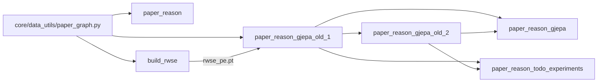

# `train/` file map

Run every file as a module from `Analysis/`, e.g. `python -m train.papers`. Each `<name>.py` reads `configs/<name>.yaml`.

## Benchmark entry points

They all follow the same shape: config → `create_dataset` → `create_model` → `core.trainer.run` or `run_k_fold`. `train.backend` (default `lightning`) chooses the loop.

| File | Dataset | Driver | Objective |
|---|---|---|---|
| `papers.py` | Scientific papers (homogeneous graph), Part 1 of `JEPA-rea.sh` | `run_k_fold` | `vicreg` |
| `zinc.py` | ZINC molecular regression | `run` (fixed split) | `distance` |
| `exp.py` | EXP expressiveness benchmark | `run_k_fold` | `distance` |
| `mutag.py`, `proteins.py`, `dd.py` | TU graph classification | `run_k_fold` | `distance` |
| `imdbb.py`, `imdbm.py`, `redditb.py`, `redditm.py` | TU social graphs | `run_k_fold` | `distance` |
| `visualize_papers.py` | Embeds the papers corpus with a trained model and plots it | — | — |

## Reasoning experiments on the heterogeneous paper graph

The names do not describe the contents: each file's docstring still carries the name it had before it was uploaded. Do **not** move or rename `paper_reason_gjepa_old_1.py` or `_old_2.py`. Other files import them, so they are not archives.

| File | Docstring name | What it is | Run by | Imports |
|---|---|---|---|---|
| `build_rwse.py` | — | Builds RWSE positional encodings from `hetero_graphA.pt` into `rwse_pe.pt` | `JEPA-rea.sh` Part 3 | `core.data_utils.paper_graph` |
| `paper_reason.py` | `paper_reason_compare.py` (v5) | Three-variant JEPA comparison: leak-safe masking, unit-hyperbola target, link prediction | `JEPA-rea.sh` Part 2 | `core` only |
| `paper_reason_frozen_features.py` | — | Option B: one shared encoder, one head per aspect, masked-aspect prediction | manual | `core` only |
| `paper_reason_gjepa_old_1.py` | `paper_reason_gjepa.py` (v5.2) | **Base library.** Faithful Graph-JEPA, hyperbola-collapse diagnosis, pooling sweep | imported | `core` only |
| `paper_reason_gjepa_old_2.py` | `paper_reason_jepa_settrans.py` | Set-transformer pooling, multi-anchor hyperbolic JEPA, relational hetero, oracle retrieval | imported | `_old_1` |
| `paper_reason_gjepa.py` | `paper_reason_euclidean_fix.py` | Reviewer gaps 1 and 2: trained Euclidean-cosine JEPA, plus timing and cost | `JEPA-rea.sh` Part 3 | `_old_1`, `_old_2` |
| `paper_reason_todo_experiments.py` | v3.1 | Extended stage list: information ladder, rho sweep, contrastive stages, figures | `JEPA-rea_todo_experiments.sh` Part 4 | `_old_1`, `_old_2` (via `importlib`) |

If these get proper names one day, rename them all at once and update the importers, `JEPA-rea*.sh` and `diag/adapters.py` (which references `train.paper_reason_gjepa:train_for_diag` in its `GJEPA_TRAIN_HOOK` hint) in the same pull request.
