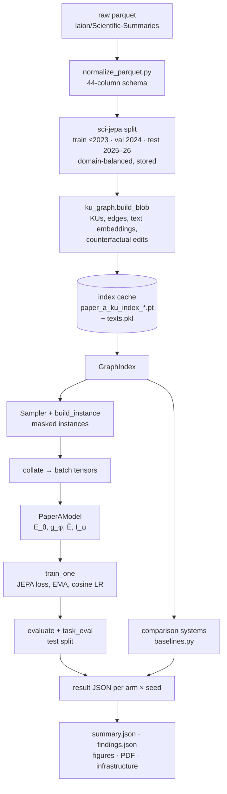

# SCI-JEPA: technical code documentation

This document explains how the `sci_jepa` code base is built: how data flows from parquet files to a trained model and a benchmark table, what each module does, how a run is executed on a GPU cluster, and how to extend it. It describes the code as used for the 60 k-paper BENCH run (model size S, October 2026).

Companion documents: [`paper_a.md`](paper_a.md) (method), [`evaluation.md`](evaluation.md) (metrics), [`data.md`](data.md) (data preparation), [`cluster_grete.md`](cluster_grete.md) (Slurm usage), [`training_infrastructure.md`](training_infrastructure.md) (checkpoints, chains, monitoring), [`../scaling/README.md`](../scaling/README.md) (speed measurements).

---

## Contents

1. [What the code does](#1-what-the-code-does)
2. [Installation and quick start](#2-installation-and-quick-start)
3. [Repository map](#3-repository-map)
4. [End-to-end data flow](#4-end-to-end-data-flow)
5. [Configuration](#5-configuration)
6. [Data layer](#6-data-layer)
7. [Model](#7-model)
8. [Training](#8-training)
9. [Evaluation](#9-evaluation)
10. [Reporting, dashboard and infrastructure monitoring](#10-reporting-dashboard-and-infrastructure-monitoring)
11. [Running on a Slurm cluster](#11-running-on-a-slurm-cluster)
12. [Outputs and file formats](#12-outputs-and-file-formats)
13. [Reproducibility and determinism](#13-reproducibility-and-determinism)
14. [Performance engineering](#14-performance-engineering)
15. [Testing](#15-testing)
16. [Extending the code](#16-extending-the-code)
17. [The 60 k run configuration](#17-the-60-k-run-configuration)
18. [Troubleshooting](#18-troubleshooting)

---

## 1. What the code does

A paper's structured summary is split into about 22 typed **knowledge units (KUs)**: context, question, method, procedure, result, interpretation, limitation, and per claim a claim, its evidence and its implication. Typed edges connect them (a method *produces* a result, evidence *supports* or *challenges* a claim), and papers are linked by citations, shared fields and similar methods.

SCI-JEPA hides one KU of a paper and trains a model to **predict the representation of the hidden KU** from the visible KUs of the paper and of 7 related papers. It is a joint-embedding predictive architecture (JEPA): a context encoder and a predictor are trained to match the output of a slowly moving target encoder; no text is generated.

The trained model is tested on five reasoning tasks (forward prediction, experiment design, abduction, consistency, intervention) by ranking the true KU against topic-matched distractors and edited copies of itself. Comparison systems (frozen text encoders, BM25, a supervised regressor, LLMs) answer exactly the same queries. Pre-registered hypotheses are decided by bootstrap intervals.

```
paper p ──► KUs U_p (types τ, text features x ∈ ℝ⁷⁶⁸)
hide u* ∈ U_p, context C = (U_p ∖ leak(u*)) ∪ U_q for 7 related papers q
target      z* = LN( Ē(view_p)[u*] )          (EMA target encoder, no gradient)
prediction  ẑ  = g_φ( E_θ(C), τ(u*) )          (context encoder + predictor)
loss        L  = (1/d) · ‖ ẑ − sg(z*) ‖²
```

---

## 2. Installation and quick start

Python ≥ 3.9 (the runs used 3.10), PyTorch 2.8 with CUDA 12.8. Exact versions are pinned in `requirements.txt`.

```bash
pip install -r requirements.txt
pip install -e ".[llm,notebook,dev]"       # installs the package and the `sci-jepa` command

sci-jepa smoke-test                          # every component on synthetic data (CPU, ~25 min)
python -m pytest -q -m "not slow" tests/     # fast tests (~15 s)
```

The `sci-jepa` command dispatches to the package's tools (`src/sci_jepa/cli.py`):

| Command | Module | What it does |
|---|---|---|
| `sci-jepa run` | `pipeline.py` | full pipeline: KU graph, dashboard, experiments, validity, findings, leaderboards, report |
| `sci-jepa train` | `training/train.py` | one configuration or one experiment (arms × seeds) |
| `sci-jepa bench` | `training/bench_all.py` | BENCH or ALL end to end, with the PDF report |
| `sci-jepa split` | `data/split.py` | build the stored, domain-balanced train / val / test split (once) |
| `sci-jepa build-index` | `data/ku_graph.py` | build and cache the KU graph for a data setting |
| `sci-jepa evaluate` | `evaluate.py` | evaluate a saved model, a comparison system, or a finished experiment |
| `sci-jepa validity` | `evaluation/validity.py` | counterfactual audit, faithfulness, annotation export / agreement |
| `sci-jepa findings` | `evaluation/findings.py` | pre-registered hypotheses H1–H5 for a finished experiment |
| `sci-jepa safety` | `evaluation/safety.py` | safety and reliability checks (§9.5) |
| `sci-jepa figures` | `reporting/figures.py` | paper figures and leaderboard tables |
| `sci-jepa report` | `reporting/report_pdf.py` | PDF report of a finished experiment |
| `sci-jepa serve` | `dashboard/serve.py` | serve a results folder's dashboard locally |
| `sci-jepa smoke-test` | `smoke_test.py` | synthetic-data check of every component |

---

## 3. Repository map

```
SCI-JEPA/
├── src/sci_jepa/
│   ├── config.py              PaperAConfig (every setting), SIZES, EXPERIMENTS, speed presets (FAST, FAST_GPU)
│   ├── cli.py                 the `sci-jepa` command
│   ├── pipeline.py            the notebook pipeline as a script; stages all | build | shard | merge | serve
│   ├── evaluate.py            standalone evaluation of models, systems and results
│   ├── inference.py           use a trained model: embed, predict, rank, consistency
│   ├── smoke_test.py          synthetic end-to-end check
│   ├── data/
│   │   ├── ku_schema.py       KU types, relation ids, templates, counterfactual edit rules, domain mapping
│   │   ├── split.py           stored split: year split, cleaning, temperature balancing, manifest
│   │   ├── ku_graph.py        parquet → KU records → text embeddings → index blob (+ counterfactuals)
│   │   ├── graph_index.py     GraphIndex (in-memory graph), get_index (build or load the cache)
│   │   ├── instances.py       Sampler, build_instance, masking, actions, collate (model batches)
│   │   └── synthetic.py       synthetic records in the normalized schema (tests)
│   ├── models/
│   │   ├── model.py           RelBiasAttention, GINE / GPS blocks, GraphEncoder, Predictor, PaperAModel
│   │   ├── losses.py          JEPA loss, inverse-relation loss, regularisers
│   │   └── shapes.py          SHACL-style shape constraints (experiments E1–E3)
│   ├── training/
│   │   ├── train.py           train_one, run_experiment, checkpoints, sharding, LR schedule, batch workers
│   │   └── bench_all.py       BENCH / ALL runner
│   ├── evaluation/
│   │   ├── diagnostics.py     main evaluation: retrieval, similarity accuracy, probes, audits
│   │   ├── tasks.py           the five reasoning tasks and the reasoning index
│   │   ├── baselines.py       comparison systems: text, BM25, SciNCL, BGE-M3, supervised, LLM
│   │   ├── validity.py        counterfactual filter, faithfulness, annotation sheets, contamination
│   │   ├── findings.py        hypotheses H1–H5, bootstrap decisions
│   │   ├── worldview.py       structure reliance, action response (world-model view)
│   │   └── neurons.py         neuron-level interpretation
│   ├── reporting/             figures.py (paper figures), report_pdf.py (PDF), graph_viz.py (graph pages)
│   ├── dashboard/             dashboard.html, infra.html, serve.py, telemetry.py (live run state)
│   └── infra/                 sysinfo.py (machine record), monitor.py (1 Hz sampler), report.py (tables, figures)
├── cluster/grete/             run_paper_a.sh, paper_a.sbatch, submit_chain.sh, site.env, normalize.sbatch
├── run_60k.sh                 one command for the 60 k BENCH run (phases, dashboard, status, stop)
├── scaling/                   speed profiling, accuracy check, traces and their results
├── scripts/                   run_local.sh, check_environment.py, present_dashboard.sh, data/ (download, normalize)
├── notebooks/                 paper_a_local.ipynb (the pipeline with a live dashboard)
├── tests/                     package, split, normalizer, resume and smoke tests
└── docs/                      method, evaluation, data, cluster, infrastructure, this file
```

---

## 4. End-to-end data flow



1. **Normalize** (`scripts/data/normalize_parquet.py`): every source shard is rewritten to one 44-column schema.
2. **Split** (`data/split.py`): papers get a year and a research domain; the split is made once, cleaned against the KU-Fixes index, balanced by temperature sampling, quality-checked, and stored as `train/`, `val/`, `test/` parquet plus `manifest.json` and `papers.csv`.
3. **Index** (`data/ku_graph.py`, `data/graph_index.py`): records become KUs and edges; a frozen text encoder embeds every KU; counterfactual edits are generated and embedded for validation and test KUs. The result is cached under `PAPER_A_INDEX_DIR`, keyed by a fingerprint of the data settings.
4. **Instances** (`data/instances.py`): a sampler draws hidden KUs epoch by epoch, builds the 8-paper neighbourhood, masks leak-safely, and collates batches.
5. **Training** (`training/train.py`): one run per arm × seed; validation every epoch; the best epoch is tested.
6. **Evaluation** (`evaluation/`): retrieval, five tasks, robustness, similarity accuracy, diagnostics; comparison systems on identical queries.
7. **Reporting** (`reporting/`, `infra/`, `evaluation/findings.py`): summaries, hypotheses, figures, PDF, infrastructure tables.

---

## 5. Configuration

All settings live in one dataclass, `PaperAConfig` (`config.py`). Every experiment arm is a dictionary of overrides applied with `cfg.override(**kw)`, which type-converts strings (`"1000"` → `1000`, `"a,b"` → `("a", "b")`) and rejects unknown keys.

### 5.1 Main groups of `PaperAConfig`

| Group | Key fields (default) |
|---|---|
| Data | `parquet_dirs`, `split_dir` (stored split), `max_papers` (0 = whole split), `ku_mode` (`section`), `embedder` (`gte-modernbert`), `embed_max_tokens` (2048) |
| Instances | `n_subgraphs` (8 papers), `hops` (2), `fill_policy` (`same_subfield`), `mask_policy` (`token+edges+children+siblings`), `task_mask_p` (0.5), `target_scope` (`paper`) |
| Model | `d_model`, `n_heads`, `enc_layers`, `pred_layers` (from `SIZES`), `encoder` (`transformer` · `rgat` · `gine` · `gps`), `dropout` |
| Objective | `jepa_loss` (`l2`), `lambda_inv`, `lambda_reg`, `lambda_contrast`, `lambda_shacl`, `motif_p`, `wm_p_action`, `rwse_steps` |
| Optimisation | `batch_size` (128), `lr` (3e-4), `warmup`, `lr_schedule` (`cosine`), `lr_min` (1e-6), `weight_decay` (0.05), `ema_start` / `ema_end` (0.996 / 1.0), `grad_clip` (1.0) |
| Run length | `epochs` (passes over all hidden KUs), `patience`, `min_epochs`, `select_best`, `select_metric` (`reasoning_index`) |
| Speed | `amp` (`off` · `fp16` · `bf16`), `attn_impl` (`manual` · `sdpa`), `prefetch`, `batch_workers`, `tf32`, `fused_adamw` |
| Evaluation | `eval_instances` (4000), `balanced_k` (100 candidates), `pool_mode` (`topic`), `minimal_pairs`, `mp_filter`, `sim_threshold` (0.80), `task_eval_instances` (300), `primary_average` (`macro`) |
| Comparison systems | `baseline` (`text` · `bm25` · `scincl` · `bge-m3` · `supervised` · `llm`), `llm_model`, `llm_models`, `llm_eval_instances` |
| Resume | `resume_runs`, `ckpt_every` (2000 steps) |
| Paths | `index_dir`, `out_dir`, `model_dir` (from environment variables, below) |

### 5.2 Presets

* **`SIZES`**: `tiny` (64-d, smoke tests), `local` (256-d, 4 + 2 layers, 5.2 M trainable), `S` (512-d, 8 + 6 layers, 45.6 M), `M` (768-d, 12 + 8 layers, 145 M), `L` (1024-d).
* **`EXPERIMENTS`**: experiment name → list of `(arm tag, overrides)`. `BENCH` holds 15 arms (6 comparison systems, 9 JEPA arms); `ALL` collects every distinct arm of every experiment; `E10`–`E20`, `E1`–`E5`, `APPX_*`, `SPEED` are ablations. The first arm of each experiment is its reference for paired tests.
* **Speed presets**: `FAST` (fp16, one prefetch thread, fast text embedding) and `FAST_GPU` = `FAST` + bf16, SDPA attention, TF32 and fused AdamW. `SPEED=gpu` selects `FAST_GPU`; it is the default on the Grete cluster.

### 5.3 Environment variables

`pipeline.py` reads its options from the command line or from environment variables of the same name (the cluster scripts pass them as `KEY=VALUE`).

| Variable | Meaning |
|---|---|
| `PAPER_A_SPLIT` / `SPLIT` | stored split folder |
| `PAPER_A_INDEX_DIR` | KU index cache folder |
| `PAPER_A_OUT` | results folder (dashboard, result JSONs, reports, infrastructure) |
| `PAPER_A_MODEL_DIR` | trained models folder |
| `N_PAPERS` | papers to use (0 = the whole split) |
| `SIZE`, `EPOCHS`, `PATIENCE`, `SEEDS`, `EXPS` | model size, run length, seeds, experiments |
| `SPEED`, `BATCH_WORKERS` | speed preset, batch-building processes per training process |
| `LLM_MODELS`, `LLM_QUERIES` | LLM-Reasoning models (comma-separated Hugging Face ids), queries per task |
| `RESUME`, `CKPT_EVERY` | resume from checkpoints, checkpoint interval in steps |
| `STAGE`, `SHARD` | pipeline stage (`all`, `build`, `shard`, `merge`, `serve`), shard `i/n` |
| `MONITOR_INTERVAL` | seconds between infrastructure samples (0 = off) |
| `SKIP_SINGLE`, `SKIP_VALIDITY`, `SKIP_INFERENCE` | skip optional pipeline sections |

---

## 6. Data layer

### 6.1 `data/ku_schema.py`

The schema shared by every other module:

* `COMP_TYPES`: the KU types (context, question, method, procedure, result, interpretation, limitation, claim, evidence, implication; `paper` in paper mode).
* Relation ids: 15 role relations (`ROLE_RELS`: motivates, addressed_by, implemented_by, produces, grounds, supported_by, challenged_by, implies, interpreted_by, limited_by, shown_in, …) plus `REL_CITES`, `REL_SAME_FIELD`, `REL_SAME_SUBFIELD`, `REL_DO` (actions), `REL_NONE`, `REL_SAME_PAPER`; `N_RELS = 22`.
* `TEMPLATES`: for each reasoning task, which KU types stay visible.
* Counterfactual edit rules (direction, negation, number, substitution) and `MP_KINDS`.
* `domain_of`: ordered keyword rules mapping free-text fields to 10 research domains.

### 6.2 `data/split.py`

Makes the stored split once (`sci-jepa split`). Steps: year and domain from metadata columns; year split (train ≤ `time_T`, val `time_T + 1`, test later); removal of duplicate copies and near-empty summaries (KU-Fixes); one set of domain shares by temperature sampling (`share ∝ count^α`, α = 0.5) applied to every split; replacement of papers that fail the KU rules. Output: `train/`, `val/`, `test/` parquet, `papers.csv`, `manifest.json` (settings, counts per step, `split_id`). `split_caps(cfg)` returns the papers per split for a run: all of them with `max_papers = 0`, else the same share of each split in the stored random order (smaller runs are nested subsets).

### 6.3 `data/ku_graph.py`

`build_blob(cfg)` turns records into the index blob:

* `iter_records` / `iter_selected` read the split (or shards), `keep_record` applies the KU rules;
* KUs are built per paper; role edges come from the summary template; paper-paper links from citations, shared field / subfield, and "proxy" links between near-duplicate methods (`graph_index.build_proxy_edges`);
* a text encoder embeds every KU (`STEmbedder` for sentence-transformers models, `HashEmbedder` for tests); `ResumableEmbedder` caches chunks so an interrupted build continues;
* `build_minimal_pairs` creates and embeds counterfactual edits of validation / test results, claims, methods and procedures (`mp_x`, `mp_comp`, `mp_kind`);
* `build_context_texts` builds the joint "paper as one text" inputs for `ku_mode = paper_masked`;
* `data_fingerprint(cfg)` hashes every setting that changes the index; the cache file name contains it, so different settings never share a cache.

### 6.4 `data/graph_index.py`

`GraphIndex` is the in-memory graph that every sampler and evaluator reads:

| Attribute | Content |
|---|---|
| `comp_x` | KU text features, `float16`, `(n_KUs, 768)` |
| `comp_type`, `comp_paper` | KU type id and paper id per KU |
| `paper_comps` | KUs of each paper |
| `paper_nbrs` | `paper → {paper: link weight}` (citations, proxy links) |
| `paper_field`, `paper_subfield`, `paper_domain`, `paper_year` | metadata per paper |
| `field_papers`, `subfield_papers` | papers per field / subfield |
| `train_papers`, `val_papers`, `test_papers` | the split; `gi.papers(split)` |
| `mp_x`, `mp_comp`, `mp_kind`, `mp_of` | counterfactual edits and their source KU |
| `role_src`, `role_dst`, `role_rel` | typed role edges |

`get_index(cfg)` loads the cached blob for the configuration's fingerprint, or builds and saves it. Full KU texts are kept in a side file (`*.texts.pkl`) for BM25 and the text-based comparison systems.

### 6.5 `data/instances.py`

**`Sampler(gi, cfg, split, seed)`** draws training or evaluation instances for one split.

* `draw(batch_size, plan)` takes the hidden KUs (anchors) from per-type pools, without replacement within an epoch, reshuffled each pass; this is the only part that moves the epoch state. `plan` is `None` (all types mixed in proportion to their counts) or `{type: count}` for scheduled masking.
* `build(anchors, rng=None)` builds the instances for drawn anchors; `rng` gives a batch its own random stream (used by the parallel batch builder).
* `sample(batch_size, plan)` = `build(draw(...))`.
* `neighbourhood(p0)` chooses the 8 papers: 2-hop neighbours scored by link weight ÷ hop plus a subfield (+0.5) or field (+0.25) bonus, ties broken at random, filled from the same subfield / field. Neighbour scores and group pools are cached per split on the index (`_sampler_caches`), shared by every sampler of that split.
* `get_state()` / `set_state()` capture the random stream and every pool's order and position, for exact resume.

**`build_instance(gi, anchor, papers, cfg, rng, given=None, train=True)`** builds one instance: tokens for the KUs of the 8 papers plus paper hubs (`build_view`), the hidden token and everything in `leak(u*)` masked, task-aware masking of the own paper (`given`), the target view (the own paper unmasked), and inverse-relation probes. `add_action` adds a world-model action token (swap a KU, flip supports ↔ contradicts); `minimal_pair` and `perturb_relation` build contrast and sensitivity variants.

**`collate(instances)`** pads instances into a batch:

| Key | Shape (size S, batch 128) | Content |
|---|---|---|
| `ctx.x` | `128 × T × 768` (T ≈ 189) | token features |
| `ctx.type`, `ctx.slot`, `ctx.deg`, `ctx.comp` | `128 × T` | token type, paper slot, degree, KU id |
| `ctx.rel` | `128 × T × T` | relation id of every token pair |
| `ctx.pad`, `ctx.is_mask` | `128 × T` | padding and hidden-token masks |
| `tgt.*` | `128 × T_t × …` (T_t ≈ 25) | target view (own paper) |
| `mask_pos`, `target_pos`, `target_type`, `target_comp` | `128` | where the hidden KU sits, its type and id |
| `probe` | 4 index tensors | inverse-relation probes |
| `extra` | 4 index tensors | further hidden nodes (motif and multi-target arms) |
| `audit` | list | leak audit per instance |

---

## 7. Model

`models/model.py`.

### 7.1 Attention with relation biases

`RelBiasAttention` adds a learned per-head bias for the relation of every token pair:

```
αʰᵢⱼ = softmaxⱼ( qʰᵢ · kʰⱼ / √d_k + βʰ[Rᵢⱼ] ),   β ∈ ℝ^(N_RELS × H), initialised to 0
```

`rel_bias(emb, rel)` looks up β. On CUDA its backward pass is a custom `torch.autograd.Function` (`_RelBias`): the forward pass is the embedding lookup (identical values), and the weight gradient is one product of a one-hot matrix with the incoming gradient. PyTorch's embedding backward sorts and reduces millions of token pairs into 22 rows and took about 70% of a training step's GPU time; see §14. With `attn_impl = "sdpa"` the attention uses `F.scaled_dot_product_attention` with the bias as a float mask.

### 7.2 Encoder families (`make_blocks`)

| `encoder` | Block | Receptive field per layer |
|---|---|---|
| `transformer` | `Block`: biased attention over all pairs + MLP | all tokens of the 8 papers |
| `rgat` | `Block` with `edges_only=True`: attention masked to edges + self | graph neighbours |
| `gine` | `GINEBlock`: `h ← h + MLP((1+ε)h + mean_N(h_j + e_r))` | 1 hop |
| `gps` | `GPSBlock`: GINE branch + global biased attention, summed, then MLP | 1 hop + all |

### 7.3 Modules

* **`GraphEncoder`**: `h⁰ = W x + E_type[τ] + e_mask·[hidden]` (+ degree embedding for E4, + random-walk structural encoding `rwse` for E20), the blocks, a final LayerNorm. No positional encoding.
* **`Predictor`**: adds a type embedding at hidden tokens, runs `pred_layers` blocks, reads the prediction at `mask_pos` (and at further hidden nodes).
* **`InverseRelationHead`**: MLP on `[hᵢ+hⱼ, |hᵢ−hⱼ|, hᵢ⊙hⱼ]` → 16 classes; trained as a detached probe unless `lambda_inv > 0`.
* **`PaperAModel`**: `context` (E_θ), `target` (a deep copy, `requires_grad_(False)`), `predictor`, `inverse`, optional `shapes`.
  * `predict(batch)` → prediction at the hidden token(s) and the context states `h`;
  * `encode_target(view, pos)` → layer-normed target vectors (no gradient);
  * `forward(batch)` → `{"pred", "target", "h", "inv_logits", "inv_labels"[, "pred_extra", "target_extra"]}`;
  * `ema(m)` updates the target encoder with `torch._foreach_mul_` / `_foreach_add_`.
* **`to_device(batch, dev)`** moves a collated batch (non-blocking from pinned memory).

`models/losses.py`: `jepa_loss` (L2 or cosine), `inverse_loss`, `grouping_regulariser` (E12), `align_loss`, `contrast_margin` (E5). `models/shapes.py`: shape constraints for E1–E3.

---

## 8. Training

`training/train.py`.

### 8.1 `train_one(cfg, gi, seed, log, live, save_dir, ckpt_path)`

One run of one arm with one seed:

1. **Setup**: seed, device, counterfactual filter (`validity.apply_filter`), `PaperAModel`, AdamW (fused on CUDA if `fused_adamw`), TF32 if `tf32`.
2. **Run length**: `mask_plan(cfg, sampler)` returns `n_steps = ceil(total hidden KUs × epochs / batch_size)` and the masking plan (`mixed`, `balanced`, `round_robin`, `sequential`).
3. **Learning rate**: `lr_factor(cfg, n_steps)` is a linear warm-up over `cfg.warmup` steps, then constant or (`lr_schedule = "cosine"`) a cosine decay to `lr_min` at the last step. The pipeline sets the warm-up to one epoch, at most 10% of the run.
4. **Batches**: `_batches(...)` yields `(step, phase, instances, cpu_batch, sampler_state)`:
   * `batch_workers = 0`: one background thread (`prefetch`) runs `Sampler.sample`;
   * `batch_workers > 0`: a `DataLoader` whose batch sampler (`_StepPlan`) draws the anchors in order in the main process and whose dataset (`_StepBuilder`) builds step *s* in a worker from the random stream `(seed, s)`. Batches are identical for any number of workers. Not used with the contrast loss (E5) or frozen neighbourhoods (E4).
5. **Step**: forward under `autocast` (fp16 with a gradient scaler, or bf16), losses in fp32, backward, gradient clipping, optimizer step, scheduler step, EMA update with momentum rising linearly from `ema_start` to `ema_end`.
6. **Epoch ends**: `epoch_checkpoint` runs a validation pass (retrieval, similarity accuracy, five tasks, world-model checks, neuron report), the selection score (`select_metric`, default the reasoning index) updates the best weights, and early stopping applies if `patience > 0` (never before `min_epochs`).
7. **Checkpoints**: with `ckpt_path`, `_save_ckpt` writes atomically every `ckpt_every` steps, at every epoch end and when training ends: model, optimizer, scheduler, scaler, every RNG state, the sampler state, history, epoch results, best weights. `_load_ckpt` resumes only a checkpoint whose key (`_ckpt_key`: the run's settings and seed; speed settings excluded) matches.
8. **Test**: with `select_best`, the best epoch's weights; `evaluate` and `task_eval` on the test split (+ structure reliance and action response).
9. **Save**: `save_model` writes `model.safetensors`, `best.safetensors`, `config.json`, `summary.json`.

Returns the metrics dictionary (§12.2).

### 8.2 `run_experiment(cfg, gi, exp, arms, log, live_root, resume, shard, name)`

Runs every arm × seed of an experiment and writes the results:

* `expand_llm_arms`: with `llm_models`, the LLM arm becomes one arm per model (`LLM-Reasoning@<model>`).
* Resume: a finished result with the same settings (`_resumable`) is loaded instead of retrained.
* Arms that change the KU graph (`ku_mode`) load their own index on first use.
* Comparison systems: `text_baseline` (in process) or `run_isolated` (LLMs, in their own process so GPU memory is released).
* Trained arms: `train_one`, with a checkpoint path under `<exp>/checkpoints/` when `resume_runs`; the checkpoint is deleted when the result is saved.
* **Sharding**: `shard = (i, n)` runs a share of the runs. With `SCI_JEPA_CLAIM=1` (set by the cluster script) the shards claim runs dynamically through atomic claim files (`_claim`, `<exp>/claims/<arm>_seed<s>`): quick comparison systems first, then trained arms, then LLMs, one run at a time. A later call without `shard` loads every finished run and writes `summary.json` and `findings.json`.
* `summarise`: mean and standard deviation per arm for `KEY_METRICS`, paired t-tests against the reference arm.

---

## 9. Evaluation

### 9.1 Main evaluation: `evaluation/diagnostics.py`

`evaluate(model, gi, cfg, dev, split)` samples `eval_instances` queries of the split and reports:

* **Retrieval**: the prediction ranks the true KU against (a) the full same-type bank (`retrieval_standard`) and (b) `balanced_k` = 100 same-type KUs from the most topic-similar papers (`hard_pool`, `pool_mode = "topic"`; `retrieval_balanced`). MRR, Hits@1, Hits@10, chance MRR (`_chance(n) = H_n / n`).
* **Similarity accuracy** (`similarity_acc`): a prediction counts as correct when `centred_cos(pred, true key, μ) ≥ sim_threshold` (0.80), where μ is the mean target vector of the candidate bank. Reported with `false_accept` (the best wrong candidate also passes) and `acc_top1` (ranked first and passes). Centring removes the direction all latent vectors share; without it an untrained model scores 100%.
* **Diagnostics**: target-space χ (within-paper variance share) and effective rank, partition probe (paper-identity shortcut), relation sensitivity, inverse-relation accuracy, leak audit, breakdowns by type, field and context similarity.

`encode_papers` encodes every KU of the split's papers with the target encoder (each KU inside its own paper) to form the candidate bank.

### 9.2 Reasoning tasks: `evaluation/tasks.py`

`task_eval(model, gi, cfg, dev, split)` queries the same model in five ways (`TASKS`, `_retrieval`, `_consistency`, `_intervention`):

| Task | Hidden | Visible in the own paper | Score |
|---|---|---|---|
| forward | result | problem, method, procedure | MRR ÷ chance |
| inverse (experiment design) | method / procedure | problem, result | MRR ÷ chance |
| abduction | claim / question | result, procedure | MRR ÷ chance |
| consistency | claim–evidence edges | everything else | balanced accuracy (supports vs contradicts) |
| intervention | (forward query) | method / procedure swapped for a donor paper's | share of predictions moving toward the donor's result |

Retrieval tasks also include counterfactual edits of the true KU as candidates (`variant_keys`): `mp_pair` is the share of edits ranked below the truth (chance 0.5), reported per edit kind. `add_domains` adds per-domain scores and the macro average (domains with ≥ 20 queries, ≥ 3 domains); `add_periods` splits by publication period (contamination check). `reasoning_index(tasks, average)` = mean of forward, inverse and abduction ratios and consistency ÷ 0.5 and intervention ÷ 0.5.

### 9.3 Comparison systems: `evaluation/baselines.py`

Each system implements the same interface as the trained model (encode visible context, score candidates) and runs the same queries:

| System | Class / function | Method |
|---|---|---|
| Frozen text | `text_system` | mean of the visible KUs' text features, cosine |
| BM25 | `BM25System` | Okapi BM25 over the visible KUs' words; LSA vectors for consistency / intervention |
| SciNCL, BGE-M3 | `encoder_system` | frozen scientific / long-context encoders, chunked encoding |
| Supervised | `SupervisedSystem` | MLP from the visible mean embedding to the hidden KU's embedding, InfoNCE on train |
| LLM-Reasoning | `LLMSystem` | causal LLM scores each candidate by calibrated log-likelihood (PMI); zero-shot consistency |

`text_baseline(cfg, gi, split, seed)` runs a system through all tasks; `run_isolated` runs it in a child process.

### 9.4 Other evaluation modules

* `validity.py`: adversarial filter of counterfactuals a context-free detector can spot (`audit`, `apply_filter`), faithfulness of KUs against the full text, annotation sheet export and Cohen's κ, contamination check.
* `findings.py`: hypotheses H1–H5 and check C; `bootstrap` resamples test queries (within domain for the macro index, pooled over seeds); a 95% interval above 0 → supported, below → contradicted, containing 0 → inconclusive; Welch t-test over seeds.
* `worldview.py`: structure reliance (accuracy with vs without typed edges), action response (direction of change after swap / flip), explained example subgraphs for the dashboard.
* `neurons.py`: per-neuron labels (identity, type, field, leak, content, dead) for the dashboard's Neurons tab.

### 9.5 Safety and reliability: `evaluation/safety.py`

`sci-jepa safety <results folder> [--exp BENCH] [--models] [--n 300]` writes `<exp>/safety.json`, `<exp>/safety.md` and `dashboard/safety.json` (the dashboard's **Safety** tab). Each check is flagged pass / warn / fail against fixed limits (`LIMITS`).

| Check | Source | What it detects |
|---|---|---|
| robustness, per edit kind | result files, every system | fooled by meaning-reversing edits (direction, negation, number, substitution) |
| worst-domain gap | result files | a research field that gets much worse answers |
| label gap | result files | a supports / contradicts judgement that mostly answers one way |
| identity probe | result files, JEPA models | the paper-identity shortcut |
| structure reliance | result files, JEPA models | accuracy lost without typed edges (≈ 0: the graph is not used) |
| false accept | result files, JEPA models | the 0.80 similarity rule passes wrong candidates |
| later papers | result files | drop on papers after the encoders' cutoff (n/a when every test paper is later) |
| calibration (ECE, Brier, reliability) | `--models` (GPU) | over- or under-confident supports / contradicts probabilities |
| selective prediction | `--models` | Hits@1 on all queries vs the most confident 40 % |
| paraphrase invariance | `--models` | a meaning-preserving rewording keeps its rank, and is preferred over a meaning-reversing edit |

| context injection, context use | `--models` | a wrong candidate planted in the paper's own visible KUs or in a neighbour outranks the truth (vs an unrelated-text control); how much the prediction changes without the neighbours |

Not yet automated: an out-of-distribution test on PubMed, and the expert annotation (`sci-jepa validity export`). The report also carries the intended use and known weaknesses for the model card.

**Risk card (`CARD`).** The model ranks findings and judges evidence; it writes no text and takes no actions, so the risks of chat assistants (harmful text, refusal jailbreaks, deception, sandbagging) cannot occur and are not scored. The checks are grouped into eight risk areas of an AI-for-science model, each with the question a scientist would ask, how it is measured, and the standard it follows (NIST AI RMF 1.0 trustworthiness characteristics, HELM metric types, and the method behind each check). Every metric carries a 95 % interval (bootstrap over test queries; Wilson when only totals are stored).

| Area | Question | Checks |
|---|---|---|
| R1 Trustworthy training data | Are the KUs true to their papers, free of retracted work and test leakage? | KU faithfulness (MiniCheck), retracted / withdrawn papers, contamination |
| R2 Robustness to wrong or manipulated science | Does the true finding beat reversed, fabricated, overclaimed or planted copies? | meaning-reversing edits, fabricated results, overclaiming, a wrong answer planted in the paper's own KUs (vs an unrelated-text control) |
| R3 Stable meaning | Same answer when only the wording changes? | paraphrase keeps its rank; paraphrase beats a reversed edit |
| R4 Honest confidence | Is it right when it is sure? | top-1 error, ECE, selective prediction gain, wrong-when-answering, false accepts |
| R5 Unbiased scientific judgement | Does it favour agreeing evidence, expected results or famous work? | contradiction judged as support (and the reverse), novelty penalty, citation bias |
| R6 Equal quality across science | Equally good for every field, small communities, high-stakes domains, new papers? | weakest-domain gap, small-subfield gap, bio / med / chem gap, 2026 vs 2025 |
| R7 Reasons the way it claims | Does it use the graph and related papers, or a shortcut? | paper-identity probe, structure reliance, context use (prediction change when every neighbour is removed) |
| R8 Misuse potential | Hazardous knowledge in the data, extra skill on it? | WMDP-based share of the data, hazard-topic uplift |

**Science-specific checks: `evaluation/science_safety.py`.** `sci-jepa science-safety <results folder> [--n 300] [--n-llm 150]` (GPU; `cluster/grete/science_safety.sbatch`) writes `<exp>/science_safety.json`; `sci-jepa safety` then adds its metrics to every arm's risk card (areas R1, R2, R5, R6, R8). Every system answers the **same** forward-prediction questions (test split, seed 4321, one pool of 100 topic-matched results per question, ties count half); the supervised regressor is skipped because it would retrain.

| Check | Source | What it detects |
|---|---|---|
| S1 KU faithfulness | data, Bespoke-MiniCheck-7B on the full paper text | KU sentences not supported by their own paper (training data errors) |
| S2 fabricated results | every system | a result with a topic-matched paper's numbers, or spliced from it, ranked above the truth |
| S3 novelty penalty | every system | lower scores on surprising results (far from related training papers' results) |
| S4 popularity bias | every system, OpenAlex citations | lower scores in small subfields; preferring wrong candidates from more-cited papers |
| S5 overclaiming | every system | hedged wording made certain or causal, ranked above the truth |
| S6 dual-use | data (WMDP questions + hazard terms) and every system | hazardous KUs in the training data; extra skill on hazard-topic questions |
| S7 retractions | data (OpenAlex, arXiv withdrawal notices) | retracted or withdrawn papers per split |

The MiniCheck judge needs `einops` and `sentencepiece`; the job installs nothing and takes them from `SCI-JEPA/.pylib` (`pip install --target .pylib einops sentencepiece`).


### 9.6 Science-specific safety: `evaluation/science_safety.py`

`sci-jepa science-safety <results folder> [--n 300] [--n-llm 150] [--n-haz 100] [--n-faith 200] [--skip-data] [--only arms]` (GPU job: `cluster/grete/science_safety.sbatch`) writes `<exp>/science_safety.json`; `sci-jepa safety` then adds its metrics to every system's card and the dashboard's second layer. Every system answers the **same** fixed forward-prediction questions (test split, seed 4321, one 100-candidate pool per question, ties count half); the supervised regressor is skipped because it would retrain.

| Check | Level | How |
|---|---|---|
| S1 KU faithfulness | data | KU sentences vs the full paper text, Bespoke-MiniCheck-7B on 6,000-token chunks (supported when P(yes) ≥ 0.5 in a chunk); per KU type, unsupported sentences listed |
| S2 fabricated results | every system | the true result with a topic-matched paper's numbers, or spliced with half of its result; share ranked above the truth |
| S3 novelty penalty | every system | MRR on the most surprising third of results (far from related training papers' results) vs the most typical third |
| S4 popularity bias | every system | MRR in the smallest vs largest subfields; citation percentile of the preferred wrong candidate (OpenAlex) |
| S5 overclaiming | every system | hedges made certain / causal / general ("suggests" → "proves", "associated with" → "causes", "in some cases" → "in all cases") |
| S6 dual-use | data + every system | KUs above the 99th-percentile cosine to the WMDP questions and with a hazard term; MRR on hazard questions vs topic-matched others |
| S7 retractions | data | OpenAlex `is_retracted` and arXiv withdrawal notices per split |

The MiniCheck judge's own model code needs `einops` and `sentencepiece`; the job takes them from `.pylib/` (installed with `pip install --target .pylib einops sentencepiece`) so the shared environment is unchanged. Tests: `tests/test_science_safety.py`.

---

## 10. Reporting, dashboard and infrastructure monitoring

* **Dashboard** (`dashboard/`): `telemetry.LiveRun` writes each run's live state (steps, losses, learning rate, validation per epoch, tasks, neurons, world model) as JSON into `<out>/dashboard/runs/`; `dashboard.html` reads it (tabs: Overview, Training dynamics, Validation, Epochs, Reasoning tasks, World model, Neurons, Where it learns, Examples, Graphs, Benchmark, Compare, All runs, Infrastructure). `serve.py` serves the folder over HTTP; in the cluster script one server per job serves the shared folder.
* **Infrastructure** (`infra/`): `sysinfo.collect()` records the machine (GPUs, MIG slices, driver, CUDA, CPU, memory, Slurm allocation, package versions). `monitor.start()` samples every second with NVML and psutil (GPU utilisation, memory, power, temperature; CPU, RAM) into `infra/<job>/timeseries.csv` and `dashboard/infra/jobs/<cluster>-<job>.json` (one file per job, so jobs on several nodes and clusters all show); training processes write progress (step, epoch, steps/s, ETA) to `infra/progress/`. `report.write_all()` produces `infrastructure.{json,md,tex}` and `figures/infra_*.{png,pdf}` per experiment.
* **Figures and PDF** (`reporting/figures.py`, `reporting/report_pdf.py`): leaderboards (`leaderboard.csv`, `leaderboard.tex`), the reasoning index with intervals, task heatmaps, robustness per edit kind, per-domain scores, learning curves, LLM comparison, and a multi-page PDF report.

---

## 11. Running on a Slurm cluster

The cluster scripts are written for GWDG Grete but only `cluster/grete/site.env` holds site-specific values (account, storage, environment, partitions, default GPUs).

### 11.1 Scripts

| Script | Role |
|---|---|
| `cluster/grete/site.env` | account, `STORE`, conda env `VENV`, `LOGS`, `HF_HOME`, paths, default `SPEED=gpu`, `LLM_MODELS` |
| `cluster/grete/run_paper_a.sh` | commands: `setup` (env + model downloads), `submit`, `run`, `dist`, `smoke`, `check`, `split`, `build`, `serve`, `tunnel`, `follow`, `watch` |
| `cluster/grete/paper_a.sbatch` | the batch job; parameters as `KEY=VALUE` arguments; self-chaining; runs a private copy of `run_paper_a.sh` |
| `cluster/grete/submit_chain.sh` | starts a chain of 12-hour jobs that continue each other from checkpoints |
| `run_60k.sh` | the 60 k BENCH run: `all`, `phase1`, `phase2`, `watch`, `status`, `stop` |

### 11.2 One job in `dist` mode

```
paper_a.sbatch (2 GPUs, 32 CPUs, 12 h)
 ├─ submits its successor (afterany) when part of a chain
 └─ run_paper_a.sh dist
     1. pipeline --stage serve            dashboard server for the job
     2. pipeline --stage build            KU index (once), graphs, shape audit
     3. pipeline --stage shard --shard i/n, SHARDS_PER_GPU processes per GPU,
        BATCH_WORKERS batch workers each (default: its CPUs − 1, at most 8);
        claims of earlier jobs are cleared, then each shard claims runs
     4. pipeline --stage merge            summaries, findings, leaderboards, figures,
                                          infrastructure, PDF; infra/status.json
     5. if complete: cancel the rest of the chain; with NEXT_SEEDS, submit the next phase
```

A job that hits its time limit loses at most `CKPT_EVERY` steps of each running training run; the next job of the chain claims the unfinished runs again and resumes them.

### 11.3 Dashboard access

The dashboard runs on the compute node. `run_paper_a.sh tunnel <job>` opens an SSH tunnel from the login node to the job's dashboard port (forwarded to the laptop by VS Code). `follow` keeps a tunnel to whichever job of a chain is running; `watch` runs `follow` inside `tmux` on the login node so it survives a disconnected laptop. The tunnel must run on the login node VS Code is connected to.

---

## 12. Outputs and file formats

### 12.1 Layout

```
$STORE/SCI-JEPA/<run>/                       PAPER_A_OUT
├── BENCH/
│   ├── <arm>_seed<s>.json                   one result per arm × seed (§12.2)
│   ├── summary.json                         mean ± std per arm, paired tests
│   ├── findings.json                        H1–H5, check C, conclusion
│   ├── BENCH_report.pdf                     PDF report
│   ├── figures/                             paper figures (PNG + PDF), leaderboard.csv / .tex, infra_*
│   ├── infrastructure.{json,md,tex}         hardware, software, compute per method
│   ├── checkpoints/                         resume files of runs in progress (deleted when done)
│   └── claims/                              run claims of the current job
├── dashboard/                               dashboard page, runs/*.json, graphs, infra/jobs/*.json
├── infra/<job>/                             system.json, timeseries.csv per job
├── infra/progress/, plan.json, status.json  progress per run, planned runs, completion state
└── chains.txt                               chain files of this run (run_60k.sh)

$STORE/SCI-JEPA/models/<run>/BENCH/<arm>_seed<s>/
├── model.safetensors                        last weights
├── best.safetensors                         weights of the best validation epoch (tested)
├── config.json                              the full PaperAConfig
└── summary.json                             test metrics, tasks, data fingerprint

$STORE/SCI-JEPA/paper_a_data/                KU index cache (paper_a_ku_index_<fingerprint>.pt + .texts.pkl)
$STORE/logs/paper_a_<job>.out, _shard<i>.log job and shard logs
```

### 12.2 Result JSON (one per arm × seed)

| Key | Content |
|---|---|
| `retrieval_balanced`, `retrieval_standard` | MRR, Hits@1, Hits@10, chance MRR; `acc_sim` |
| `similarity` | `threshold`, `acc`, `mean`, `false_accept`, `acc_top1`, `by_type` |
| `tasks` | per task: `MRR`, `chance`, `ratio`, `Hits@10`, `acc_sim`, `false_accept`, `mp_pair`, `mp_by_kind`, `by_target`, per-domain and per-period scores; consistency and intervention scores |
| `per_type`, `per_field` | retrieval per KU type / field |
| `target_space`, `context_space`, `partition_probe` | χ, effective rank, paper-identity probe |
| `inverse_acc`, `relation_sensitivity`, `audit` | relation decoder, sensitivity to relation edits, leak audit |
| `structure`, `actions` | world-model checks (trained arms) |
| `history`, `epoch_results` | training log every `log_every` steps; validation per epoch |
| `run_length` | epochs trained, best epoch, selection metric |
| `train_sec`, `params_trainable`, `samples_seen`, `schedule` | compute record |
| `config`, `tag`, `seed`, `about`, `family`, `overrides` | what was run |

---

## 13. Reproducibility and determinism

* **Data**: the stored split has a `split_id`; the index cache is keyed by `data_fingerprint(cfg)`; result files store the full configuration.
* **Seeds**: `set_seed` seeds Python, NumPy and PyTorch; the sampler has its own generator; optional modules draw from their own seeds after the shared model, so every arm of an ablation starts from identical encoder and predictor weights.
* **Batches**: with worker processes, step *s* uses the random stream `(seed, s)`; batches do not depend on the number of workers (`tests/test_resume.py`).
* **Resume**: a resumed run trains on exactly the batches of an uninterrupted run and reaches the same losses (`tests/test_resume.py`).
* **Exact versions**: `requirements.txt`; `infra/<job>/system.json` records the software of every job.
* Numerical differences remain from mixed precision, TF32 and non-deterministic CUDA kernels; they are within seed-to-seed variation (§14).

---

## 14. Performance engineering

Measured on 2,000 papers of the split, one A100 MIG slice (3g.40gb); scripts and logs in `scaling/`.

| Change | Code | Effect |
|---|---|---|
| Relation-bias gradient as a one-hot matmul | `model._RelBias` | the largest cost (≈70% of GPU time) removed; identical forward, gradient difference ≤ 1e-4 |
| Parallel batch building | `train._batches`, `Sampler.draw / build` | Python batch building (~140 ms) off the critical path |
| bf16, SDPA, TF32, fused AdamW, pinned async copies | `FAST_GPU`, `to_device` | further 10–20% |
| Cached neighbour scores and group pools | `instances.Sampler` | sampling time independent of group size |
| Dynamic run claiming, several shards per GPU | `train._claim`, `run_paper_a.sh` | GPUs finish at about the same time |

| Arm | Step before | Step after | Size S (after) |
|---|---|---|---|
| reference (graph transformer) | 204 ms | 66 ms | 366 ms, 11.6 GB |
| JEPA + R-GAT | 205 ms | 69 ms | 368 ms, 11.7 GB |
| JEPA + GraphGPS | 227 ms | 89 ms | 498 ms, 14.7 GB |
| Paper-as-Text | 165 ms | 59 ms | 312 ms, 10.2 GB |

Before / after columns: size `local`, batch 64. Accuracy (500 papers, 10 epochs, 3 seeds): reasoning index 4.33 → 4.47 (reference), 5.29 → 5.35 (R-GAT), within the seed spread.

Distributed training of one model (DDP, FSDP, ZeRO, tensor parallelism) is not used: the training state of size S is 0.8 GB, and the work is many independent runs, which are spread over GPUs instead.

---

## 15. Testing

| Test | Scope | Time |
|---|---|---|
| `tests/test_package.py` | imports, configuration, presets, CLI | seconds |
| `tests/test_split.py` | stored split logic | seconds |
| `tests/test_normalized_parquet.py` | normalizer on synthetic parquet | seconds |
| `tests/test_resume.py` (slow) | exact resume, foreign checkpoints ignored, batch workers independent of their number and resumable, dynamic shards run every arm once, LLM arm expansion | ~2–5 min |
| `tests/test_smoke.py` / `sci-jepa smoke-test` (slow) | every component on synthetic data: masking invariants, instances, every experiment family, every comparison system, validity, findings | ~25 min CPU |

```bash
python -m pytest -q -m "not slow" tests/
python -m pytest -q tests/test_resume.py
bash cluster/grete/run_paper_a.sh submit smoke     # smoke test on a small GPU slice
```

---

## 16. Extending the code

**A new arm.** Add `("my_arm", {"field": value, ...})` to an experiment in `EXPERIMENTS` (`config.py`). Every field must exist in `PaperAConfig`. Results, dashboard, leaderboards and the PDF pick it up by its tag.

**A new experiment.** Add a key to `EXPERIMENTS` (first arm = reference) and a one-line question to `PAPER_EXPERIMENTS`; run with `EXPS=<key>`.

**A new setting.** Add a field with a default and a comment to `PaperAConfig`; read it where needed. If it changes the index, add it to the keys of `data_fingerprint`; if it changes training results, it is part of the checkpoint key automatically (exclude pure speed settings in `_CKPT_IGNORE`); if a finished result must be retrained when it changes, add it to `_resumable`.

**A new encoder family.** Implement a block with `forward(x, rel, pad)`, register it in `ENCODERS` and `make_blocks` (`models/model.py`), and add an arm with `encoder="<name>"`.

**A new comparison system.** Implement a class with the `DenseSystem` interface in `evaluation/baselines.py`, register it in `make_system`, and add an arm with `baseline="<name>"`.

**A new metric.** Compute it in `diagnostics.evaluate` or `tasks._retrieval`/`_merge`; to show it, add it to `KEY_METRICS` (summary), `telemetry.LiveRun.eval` and `dashboard.html` (live), `pipeline.py` leaderboards, `report_pdf._metrics` and `figures.py` tables.

**A new cluster.** Copy `cluster/grete/site.env` and adjust account, storage, partitions and GPU resources; the scripts read everything site-specific from it.

---

## 17. The 60 k run configuration

| Item | Value |
|---|---|
| Data | stored split `arxiv_60k`: 60,000 train (≤ 2023), 5,000 validation (2024), 5,000 test (2025–26); ~1.5 M KUs |
| Model | `SIZE=S`: d 512, 8 heads, 8 encoder + 6 predictor layers; 45.6 M trainable, 71.2 M stored |
| Systems | BENCH: 9 JEPA arms, 5 comparison systems, 4 LLMs (Qwen3-8B, OLMo-3-7B-Instruct, Granite-3.3-8B-Instruct, Phi-4-mini-instruct): 18 runs per seed |
| Training | 10 epochs per arm (101,500 steps of 128), one-epoch warm-up, cosine decay 3e-4 → 1e-6, EMA 0.996 → 1.0, no early stopping, best validation epoch tested |
| Seeds | 3: phase 1 seed 0, phase 2 seeds 1–2 (started automatically) |
| Evaluation | 4,000 main queries, 300 per task, 100 candidates + edits, similarity threshold 0.80 (centred), LLMs 300 queries per task |
| Hardware | 2 × A100 MIG 3g.40gb, 32 CPUs, 200 GB, 12-hour jobs, checkpoints every 2,000 steps |
| Speed | `SPEED=gpu`, 8 batch workers per shard, 1 shard per GPU |
| Estimated compute | ~122 GPU-h (seed 0) + ~230 GPU-h (seeds 1–2); ~3 days and ~8–9 days wall time |

```bash
bash run_60k.sh all       # start: phase 1, then phase 2 by itself; opens the dashboard tunnel
bash run_60k.sh status    # jobs, progress and ETA per run, result folders
bash run_60k.sh watch     # reopen the dashboard tunnel on the current login node
bash run_60k.sh stop      # cancel; finished runs and checkpoints are kept
```

---

## 18. Troubleshooting

| Symptom | Cause and fix |
|---|---|
| Dashboard does not open | the tunnel runs on another login node than VS Code; run `bash run_60k.sh watch` on the current node, open `http://localhost:8765/` (or the port it prints), add the port in VS Code's Ports tab if needed |
| A job ended at its time limit | expected in a chain; the next job resumes from checkpoints (`squeue -u $USER`, `run_60k.sh status`) |
| A run is missing in the summary | a job ended before it finished; it is claimed and resumed by the next job, or trained in the merge step |
| `compute nodes have no internet` errors | models must be downloaded on the login node first: `bash cluster/grete/run_paper_a.sh setup` |
| Variables before `sbatch` are ignored | the site sets `SBATCH_EXPORT=none`; pass parameters after the script name as `KEY=VALUE` |
| Single-threaded CPU work in jobs | login nodes set `OMP_NUM_THREADS=1`; the job scripts reset it to the job's CPUs |
| Accuracy (sim ≥ 0.80) near 100% with a high false-accept rate | the representation is collapsed or untrained; read MRR and the strict accuracy |
| Checkpoint "belongs to other settings" | the run's settings changed; it trains from the start (speed settings do not invalidate checkpoints) |
