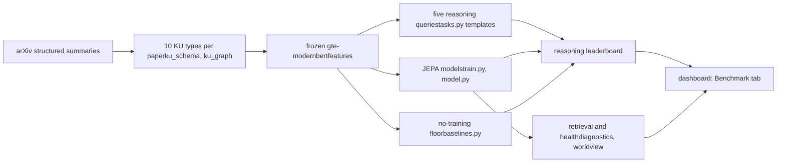

**Contents** [1 Short answers](#answers) [2 The five reasoning tasks](#tasks) [3 The key finding](#finding) [4 Making the tasks need reasoning](#design) [5 Why no-training baselines](#notrain) [6 State of the art per task](#sota) [7 Systems to benchmark](#systems) [8 Protocol and leaderboards](#protocol) [9 What the code does](#code) [10 The A\* paper](#paper) [11 Reviewer questions](#reviewers) [12 Work plan](#plan) [References](#refs)

SCI-JEPA-training · reasoning benchmark paper

# SciKU-Bench: a benchmark of five scientific reasoning tasks

The benchmark is about five kinds of scientific reasoning over the parts of a paper: forward prediction, experiment design, abduction, consistency checking and intervention. Retrieval and model-health measures are supporting analysis. This page defines the tasks, reports what a no-training baseline already achieves, shows how the tasks must change to require reasoning, and lays out the systems, protocol and paper for an A\* venue.

**Working name** SciKU-Bench**Updated** 13 Oct 2026**Code** `SCI-JEPA-training/Analysis/train/paper_a/`

## 1Short answers

| Question | Answer |
| --- | --- |
| What is the benchmark? | Five reasoning tasks over the knowledge units (KUs) of scientific papers. Main leaderboard: the **reasoning leaderboard** (one score per task plus a reasoning index). Retrieval and model health form a second, supporting leaderboard. |
| Is a no-training comparison needed? | **Yes, more than anything else.** On real data a no-training text baseline already solves three of the five tasks perfectly in their current form. Without it, the benchmark would report topic matching as reasoning. Sections 3 and 5. |
| Is the benchmark ready? | Not yet. The candidate answers must share the query's topic (topic-matched papers and minimally altered versions of the true answer) so that only reasoning separates them. Section 4. |
| What is the state of the art? | Forward prediction: BrainBench, Wen et al. (NeurIPS 2025), SciPredict. Abduction: MOOSE-Chem, ResearchBench. Consistency: SciFact. Experiment design and intervention over findings: no benchmark found; this is the gap. Section 6. |
| Which systems? | No-training floors, scientific and general embedding models, graph models, same-data trained controls, LLMs, our JEPA models, and a human expert sample. Section 7. |

## 2The five reasoning tasks

A paper is split into 10 KU types. The reasoning slots map onto them: **Problem** = context + question, **Method** = method, **Material / Condition** = procedure, **Result** = result, **Claim / Hypothesis** = claim (+ question). In each task only the "given" parts of the paper are visible; everything that restates the answer is hidden.

| Task | Given | Asked | What it tests | Score (chance) |
| --- | --- | --- | --- | --- |
| **1 · Forward prediction** | Problem, Method, Material / Condition | the Result | anticipating what an experiment will show | rank of the true result among candidates: MRR ÷ chance (1×) |
| **2 · Experiment design** (inverse) | Problem, Result | the Method / Material | inferring which setup produces a finding | MRR ÷ chance (1×) |
| **3 · Abduction** | Results, Conditions | the Claim / Hypothesis | inferring the conclusion or hypothesis that explains results | MRR ÷ chance (1×) |
| **4 · Consistency checking** | a claim and a piece of evidence, link hidden | supports or contradicts | recognising support and contradiction | balanced accuracy (50%) |
| **5 · Intervention** | a forward query with the Condition (or Method) replaced by another paper's | how the result changes | counterfactual reasoning: does the prediction follow the change? | share moving toward the other paper's result (50%) and size of the move, as a margin over the no-training baseline |

**Reasoning index** = mean of the five scores on one × chance scale (consistency and intervention divided by 0.5). **Tasks solved**: retrieval tasks ≥ 1.5× chance, consistency ≥ 65%, intervention shift ≥ 0.3 with ≥ 60% toward. Thresholds are provisional and should be fixed before the final runs.

## 3The key finding: in their current form, three tasks are solved without reasoning

The no-training text baseline (frozen gte-modernbert embeddings: mean of the visible parts, cosine to each candidate) on the real 500-paper corpus, test split:

| Task | No-training text baseline | Reading |
| --- | --- | --- |
| Forward prediction | 6.16× chance · Hits@1 = 100% | the true result is always ranked first |
| Experiment design | 6.16× · Hits@1 = 100% | method and material both always first |
| Abduction | 9.24× · Hits@1 = 100% | claim 18.5×, hypothesis 6.2× |
| Consistency | 76.5% balanced accuracy | a label-free text rule (evidence less similar to its claim = contradicts) catches 90% of contradictions |
| Intervention | 100% toward · shift 0.09 | swapping in another paper's procedure text moves the query toward that paper's result by text overlap alone |

Why this happens

The wrong candidates come from other papers. All parts of one paper share its topic and vocabulary, so the right answer is simply the candidate that "sounds like" the visible parts. The tasks currently measure topic matching. The 500-paper test split is also tiny (23 papers, \~22 candidates per query), which makes this worse, but larger corpora alone will not remove it.

This is the result a benchmark paper needs to show early: it proves the obvious approach is a strong floor, and it motivates the task design below.

## 4Making the tasks require reasoning

| Task | Required change | Why it removes the shortcut |
| --- | --- | --- |
| **Forward prediction** | **Minimal-pair distractors** as in BrainBench: altered versions of the true result (direction reversed, magnitude or comparison changed, entity swapped), generated by an LLM and checked by experts on a sample; plus **topic-matched** results from the papers whose problems are most similar. | The distractors share the paper's topic and wording; only knowing what the setup implies separates them. |
| **Experiment design** | Candidates = methods / procedures of the papers with the most similar *problem* (nearest neighbours in problem embedding), plus altered methods. | All candidates fit the topic; the right one must be the one that produces the stated result. |
| **Abduction** | Include the paper's **other claims** and altered claims as distractors: "which claim do these results support?" | Same paper, same topic; the answer depends on which result supports which claim. |
| **Consistency** | Balance lexical cues (negation, hedging words) between supporting and contradicting evidence; add matched pairs where the same evidence is paired with a claim it supports and one it contradicts; report the text-rule baseline. | Wording no longer reveals the label. |
| **Intervention** | Use **natural counterfactual pairs**: papers with the same problem and different conditions or methods, and different results. Score the move toward the partner's result *minus* the move caused by a text-matched control swap; report as a margin over the text baseline. | Text overlap moves every system toward the donor; only the margin reflects learned dependence. |

Every change keeps the same format (rank text candidates; classify a pair), so every system family can still be scored identically. Each generated distractor set needs an expert-validated sample with agreement statistics.

## 5Why no-training baselines are required

1. **They measure the difficulty of each reasoning task.** Section 3 shows why: without them, topic matching would be reported as reasoning.
2. **They calibrate the metrics.** Intervention "toward" scores and consistency accuracy only mean something as margins over what text similarity achieves.
3. **They measure what training adds.** Our trained models use the same frozen embeddings as input.
4. **They are standard** in benchmark papers (BM25 in BEIR, static embeddings in MTEB, SciBERT under SPECTER).

Fair-floor conditions: same queries, candidates and chance levels as every system; no tuning on test; label-free rules only. All are already enforced in `baselines.py`. Add BM25 and a random ranker as further floors.

## 6State of the art for each reasoning task

| Task | Closest benchmarks | What they report | What SciKU-Bench adds |
| --- | --- | --- | --- |
| **Forward prediction** | BrainBench (Nature Human Behaviour); Wen et al. (NeurIPS 2025); SciPredict | LLMs beat neuroscience experts at choosing the real result; a fine-tuned GPT-4.1 with retrieval reaches 77% on which-idea-works-better while off-the-shelf o3 is at chance; 405 outcome questions from papers after March 2025 | many fields at once; prediction from the paper's own problem, method and conditions; same format as the other four tasks |
| **Experiment design** | no benchmark found for inferring the method from a stated finding | – | a new task |
| **Abduction** | MOOSE-Chem (ICLR 2025, 51 chemistry papers); ResearchBench (12 disciplines); IdeaBench | hypotheses from background and inspirations, judged by LLMs or experts | abduction from results and conditions, scored by ranking without an LLM judge |
| **Consistency** | SciFact and successors | claim verification against retrieved abstracts | support vs contradiction inside papers' own claim–evidence structure, with lexical controls |
| **Intervention** | no benchmark found for counterfactual changes to experimental conditions in papers | – | a new task, with text-overlap controls |

Supporting analysis relates to scientific representation benchmarks (SciRepEval with SPECTER2; MTEB, where Qwen3-Embedding, NV-Embed-v2 and BGE-M3 lead) and faceted retrieval (CSFCube, DORIS-MAE, LitSearch, MAPLE).

## 7Systems to benchmark on the five tasks

| Family | Systems | How it answers the reasoning tasks | Why it is needed | Status |
| --- | --- | --- | --- | --- |
| **No-training floors** | random; BM25; frozen gte-modernbert | score candidates by similarity to the given parts; consistency by a label-free rule | task difficulty and shortcuts | text: done BM25: to add |
| **Scientific encoders** | SPECTER2, SciNCL | same, with paper-trained embeddings | does scientific pre-training help reasoning? | to add |
| **General embedders** | Qwen3-Embedding 0.6B / 8B, BGE-M3, NV-Embed-v2 | same, with the strongest current embeddings | scale and quality of text representations | to add |
| **LLMs** | an open 7–8 B model; a frontier API model; BrainBench-style likelihood scoring; optionally a fine-tuned model | rank candidates from a prompt with the given parts; classify consistency; for intervention, compare rankings before and after the swap | the strongest current approach to outcome prediction; reviewers will expect it | to add |
| **Graph models** | GraphSAGE / GAT on the KU graph; GraphMAE | predict the hidden node from the given nodes | does explicit structure help reasoning? | to add |
| **Same-data controls** | our architecture trained with InfoNCE, or with masked reconstruction | as our model | isolates the effect of the JEPA objective | to add |
| **Our JEPA models** | reference, paper-as-text, world model, motif, motif + world, Graph-JEPA + world | predict the hidden KU's representation; actions for intervention | does latent prediction with actions learn reasoning the others lack? | `BENCH`: done |
| **Humans** | domain experts, \~100 items per task | the same multiple-choice format | shows the tasks are solvable and how hard they are | to add |

## 8Protocol and leaderboards

### Main: reasoning leaderboard

- Columns: reasoning index, tasks solved, forward, experiment design (method, material), abduction (claim, hypothesis), consistency (and contradiction recall), intervention (toward the new result, shift, method swap), index vs the text baseline.
- Ranked by the reasoning index; mean ± std over 5 seeds for trained systems; paired tests and bootstrap intervals over queries.
- Breakdowns per field, per leak level and per distractor kind (topic-matched vs minimal pair).

### Supporting: retrieval and model health

- Masked-KU retrieval for all 10 KU types, learning per type, how much accuracy comes from graph structure, world-model action scores, training cost.
- Used to explain reasoning results (for example: a model that does not use structure cannot follow structural interventions), not to rank systems.

### Data controls

- Time split, plus a test set of papers published after the newest model's training data.
- Leak-safe masking and per-query leak similarity.
- Distractors never from the query's own paper except where the task asks (abduction's sibling claims).

## 9What the SCI-JEPA-training code does

| Part | Role for the reasoning benchmark | File |
| --- | --- | --- |
| Knowledge units | \~22 KUs per paper from the structured summary; leak rules (what restates what) | `ku_schema.py` |
| Corpus and splits | KU graph, time split, frozen text features | `ku_graph.py`, `graph_index.py` |
| Reasoning queries | templates for forward / experiment design / abduction; consistency on hidden claim–evidence links; intervention by swapping the condition or method | `ku_schema.py` (TEMPLATES), `tasks.py` |
| No-training floor | all five tasks on frozen text, same queries and candidates | `baselines.py` |
| JEPA models | graph transformer with relation-aware attention, EMA target, predictor; world-model actions; motif targets | `model.py`, `instances.py`, `train.py` |
| Supporting analysis | retrieval per KU type, structure reliance, action following, neuron interpretation | `diagnostics.py`, `worldview.py`, `neurons.py` |
| Benchmark run | `EXPERIMENTS = ["BENCH"]`: the floor and every JEPA variant, 5 seeds | `config.py` |
| Leaderboards | Benchmark tab: reasoning leaderboard first, retrieval and health second; the notebook prints both | `dashboard.html`, notebook |

**Still to build for the paper:** topic-matched and minimal-pair distractors (Section 4), the intervention control swap, BM25 and the other system families (Section 7) through the same scoring interface, and the post-cutoff test set.

## 10The A\* paper

**Venue:** NeurIPS **Evaluations & Datasets** track (double-blind by default; datasets must ship Croissant metadata with Responsible-AI fields on a host such as Hugging Face), or the benchmark tracks of ACL, EMNLP or KDD. Check current deadlines.

### Contributions

1. **Five scientific reasoning tasks in one benchmark**, two of them new (experiment design, intervention), defined over the parts of real papers.
2. **Shortcut-controlled task design**: evidence that naive tasks are solved by topic matching, and topic-matched and minimal-pair distractors that remove it.
3. **A broad evaluation** of embedding models, LLMs, graph models, JEPA world models and human experts on the same queries.
4. **Analysis**: which reasoning direction is hardest, whether structure and interventions are used, per-field differences.
5. **Open release** of data (where licences allow), distractors, scorer and leaderboard.

### Outline

| Section | Content |
| --- | --- |
| 1 Introduction | why reasoning over the parts of papers; the five directions; contributions |
| 2 Related work | Section 6 |
| 3 Tasks | definitions, slot mapping, the shortcut finding, distractor design |
| 4 Data | sources, KU extraction and its validation, statistics, splits, licences |
| 5 Systems | the families of Section 7 |
| 6 Results | reasoning leaderboard; per task, field and distractor kind; human comparison |
| 7 Analysis | retrieval and health leaderboard; structure and intervention; failure cases |
| 8 Limitations | LLM-generated summaries, schema-imposed edges, generated distractors, field coverage |

## 11What reviewers will ask

| Question | What to have ready |
| --- | --- |
| Is this reasoning or topic matching? | The Section 3 finding and the Section 4 distractors; results by distractor kind; the text and BM25 floors. |
| Are generated distractors valid? | Expert check of a sample: plausible, wrong, not detectable by wording; agreement statistics. |
| Are the KUs faithful to the papers? | Expert comparison of a sample of KUs with the paper text. |
| Is the intervention score meaningful? | Natural counterfactual pairs and the text-matched control swap. |
| Contamination? | Post-cutoff test set reported separately. |
| Can humans do it? | Expert accuracy per task. |
| Significance? | 5 seeds, paired tests, bootstrap intervals. |

## 12Work plan

| Phase | Work | Done when |
| --- | --- | --- |
| 1 Task design | topic-matched candidates; minimal-pair distractors for forward prediction and abduction; consistency lexical controls; intervention pairs and control swap | text baseline no longer at 100% Hits@1 |
| 2 Validation | expert checks of KUs and distractors; human answers per task | agreement and human scores |
| 3 Data at scale | 5,000- and 60,000-paper corpora; post-cutoff test set; licence audit | frozen splits |
| 4 Systems | BM25, encoders, LLMs, GNNs, same-data controls through one scoring interface | full reasoning leaderboard |
| 5 JEPA models | `BENCH`, 5 seeds, at scale | rows in both leaderboards |
| 6 Release and paper | Hugging Face dataset with Croissant + RAI metadata, scorer, leaderboard; writing | submission |

## References

- [Large language models surpass human experts in predicting neuroscience results (BrainBench)](https://www.ncbi.nlm.nih.gov/pmc/articles/PMC11860209/)
- [Predicting empirical AI research outcomes with language models (Wen et al., NeurIPS 2025)](https://arxiv.org/pdf/2506.00794)
- [SciPredict](https://labs.scale.com/api/pdf/papers/scipredict)
- [MOOSE-Chem (ICLR 2025)](https://proceedings.iclr.cc/paper_files/paper/2025/hash/51fd9a7d1706023cb9f8210cc6ac357c-Abstract-Conference.html)
- [ResearchBench](https://arxiv.org/pdf/2503.21248)
- [IdeaBench](https://arxiv.org/html/2411.02429v1)
- [SciRepEval](https://arxiv.org/abs/2211.13308v4)
- [DORIS-MAE](https://arxiv.org/pdf/2310.04678v2)
- [MAPLE](https://arxiv.org/pdf/2608.15624)
- [Graph-JEPA](https://arxiv.org/html/2309.16014v2)
- [LLM-JEPA](https://arxiv.org/html/2509.14252v2)
- [NeurIPS 2026 Evaluations & Datasets track](https://neurips.cc/Conferences/2026/CallForEvaluationsDatasets)
- [NeurIPS 2026 Responsible-AI metadata requirements](https://blog.neurips.cc/2026/05/04/responsible-ai-metadata-requirements-for-the-evaluations-and-datasets-track-neurips-2026/)
- [NeurIPS 2026 hosting guidelines](https://neurips.cc/Conferences/2026/EvaluationsDatasetsHosting)